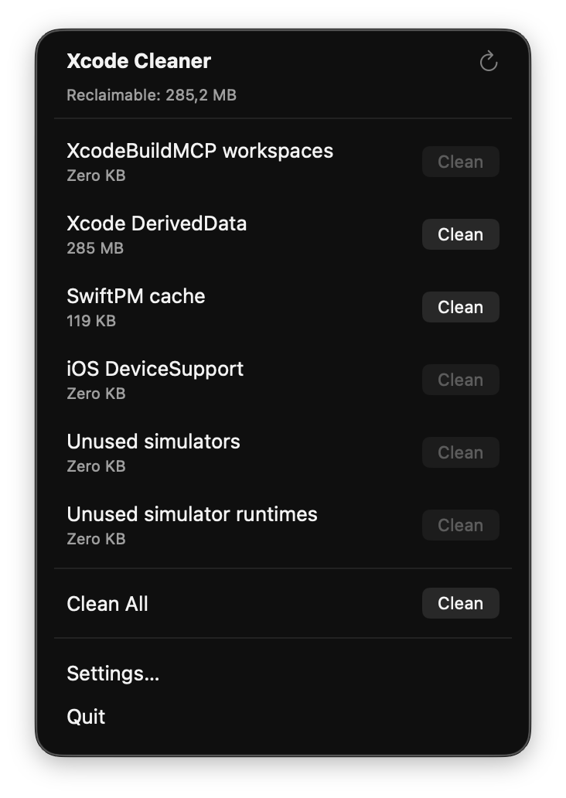
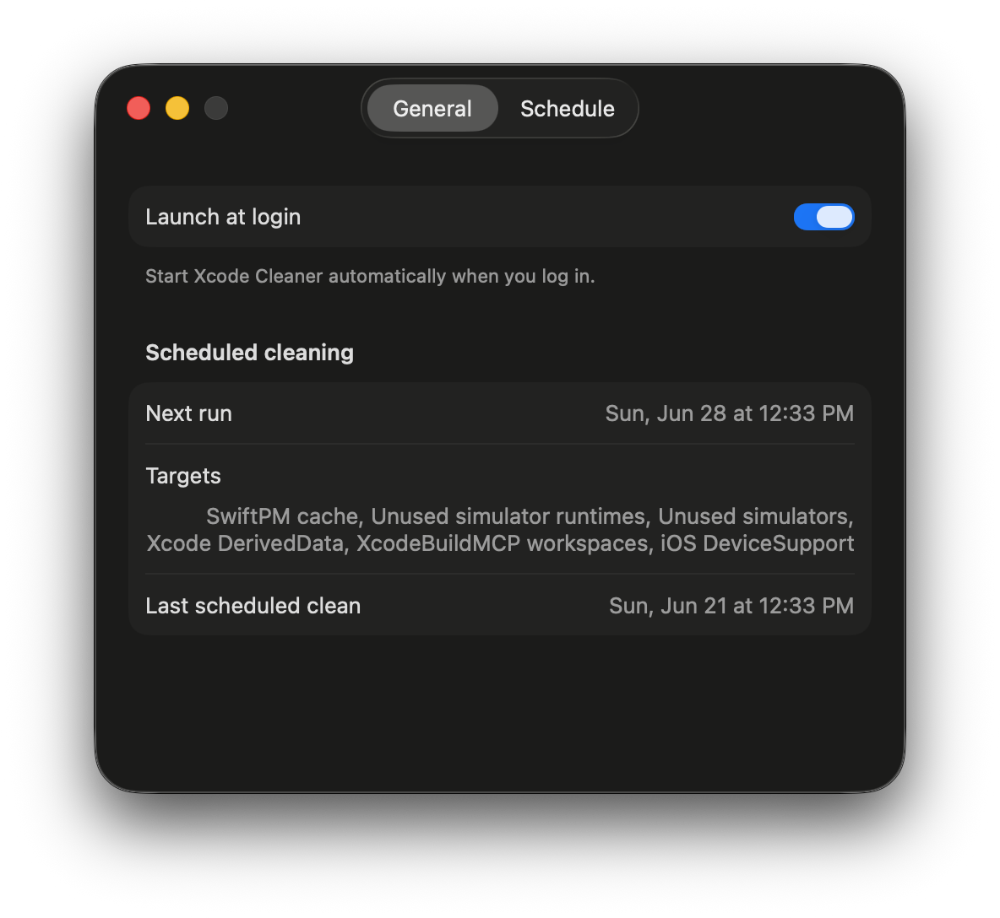
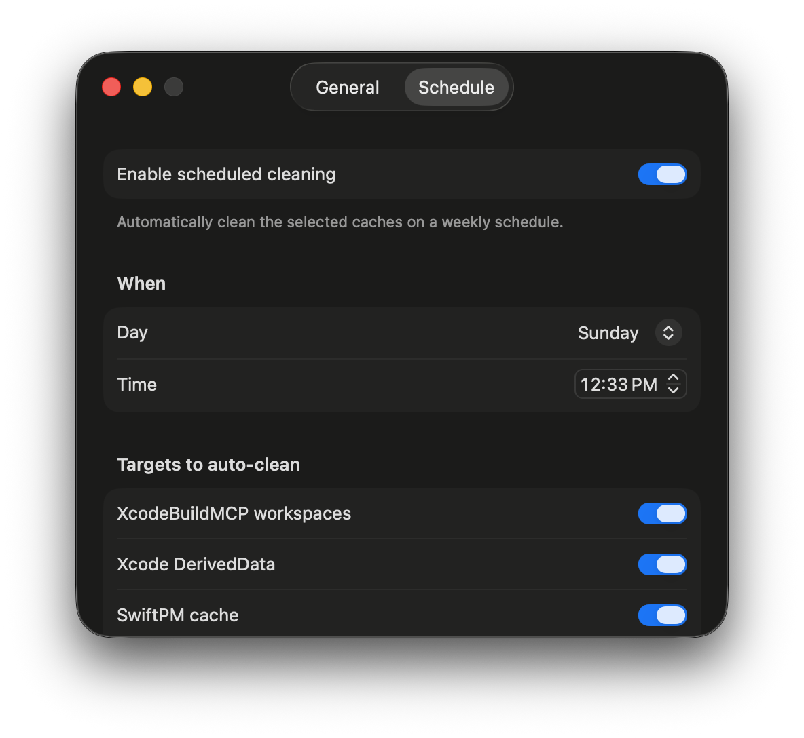

<p align="center">
  
</p>

<h1 align="center">Xcode Cleaner</h1>

<p align="center">
  A tiny macOS menu bar app that reclaims the disk space Xcode quietly eats —<br>
  DerivedData, simulators, caches, and more — with one click.
</p>

Click the ✨ sparkles icon in your menu bar to see how much space each Xcode cache is using, then hit **Clean** on the ones you want to clear. Want it hands-off? Turn on weekly auto-clean and forget about it.

## Screenshots

<p align="center">
  
</p>

<p align="center">
  
  
</p>

## What it cleans

| Cache | What it frees up |
|-------|-----------------|
| Xcode DerivedData | Build artifacts and indexes |
| SwiftPM cache | Cached Swift packages |
| iOS DeviceSupport | Old device symbol files |
| XcodeBuildMCP workspaces | XcodeBuildMCP working files |
| Unused simulators | Simulators marked unavailable |
| Unused simulator runtimes | Runtimes unused for 30+ days |

> ⚠️ **Clean removes files immediately** — there's no undo. These are all safe-to-delete caches that Xcode regenerates as needed, but anything in progress (like a fresh build's DerivedData) will be gone.

## Requirements

- macOS 14 (Sonoma) or later
- Xcode 16 or later

## Install

```bash
git clone https://github.com/billp/XcodeCleaner.git
cd XcodeCleaner
scripts/install.sh
```

This builds a signed copy, installs it to `/Applications/XcodeCleaner.app`, and launches it. You may be asked for your administrator password.

> **First time?** If the build fails with a signing error, open `XcodeCleaner.xcodeproj` in Xcode once, select the **XcodeCleaner** target → **Signing & Capabilities**, and pick your team under **Team** (a free Apple ID works). Then re-run the script. Or skip signing entirely with `scripts/install.sh --signing=NO`.

Once installed, the ✨ icon appears in your menu bar. Click it to get started.

## Auto-clean on a schedule

Open **Settings…** from the menu bar dropdown:

- **General** — turn on **Launch at login** so the app is always running to fire scheduled cleans.
- **Schedule** — enable scheduled cleaning, pick a day and time, and check the caches you want cleaned automatically each week.

XcodeCleaner won't interrupt your work: if a build is running (`xcodebuild`, `swift`, `clang`, etc.) when a scheduled clean is due, it waits an hour and tries again — for up to 24 hours — before skipping until next week.

> Launch at login requires the app to live in a stable location like `/Applications`, which `scripts/install.sh` handles for you.

## Building from source

```bash
# Build and run the test suite
xcodebuild -project XcodeCleaner.xcodeproj -scheme XcodeCleaner test

# Quick build without signing
xcodebuild -project XcodeCleaner.xcodeproj -scheme XcodeCleaner build CODE_SIGNING_ALLOWED=NO
```
